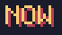
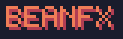
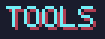

  

I build pixel-art and game-dev tools for coding agents, mostly in Rust.
Based in Viet Nam.

[**beanfx**](https://github.com/baenv/beanfx): pixel-art effects drawn as code. Describe an effect and the
Claude Code plugin draws it in Rust, then exports a sprite sheet, Aseprite JSON and a gif.

  
  
  

[Live gallery](https://beanfx.vhbien000.workers.dev/)

